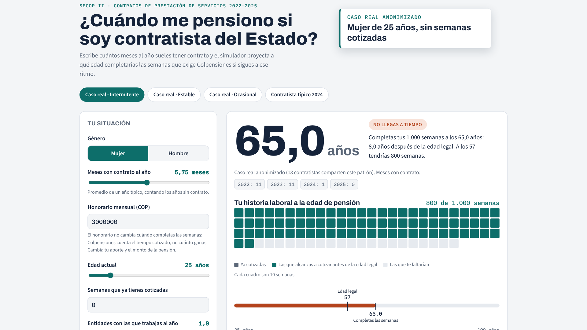

# ¿Se pensionarán los contratistas del Estado?

Trayectorias de los contratistas de prestación de servicios del Estado colombiano en **SECOP II** (2020–2026) y su camino a la pensión. El proyecto combina clustering, un modelo supervisado de continuidad y un simulador de pensión.

Proyecto final de Machine Learning, Matemáticas Aplicadas y Ciencias de la Computación, Universidad del Rosario.

**Simulador en línea:** https://jhonsr17.github.io/contratistas-secop-pension/simulador/ (código en [`simulador/index.html`](simulador/index.html)). Escribes cuántos meses al año tienes contrato y te dice a qué edad completarías las semanas que exige Colpensiones.

[](simulador/demo_simulador.mp4)

*Demo de 40 s ([`simulador/demo_simulador.mp4`](simulador/demo_simulador.mp4)): caso real intermitente (65 años), el mismo caso con 9 meses de contrato al año (50,6), un caso ocasional (117) y el contratista típico de 2024 (62,8).*

---

## Hallazgos principales

| | |
|---|---|
| Contratos analizados | 4.274.143 de 1.023.532 personas (prestación de servicios, persona natural) |
| Contratistas activos en 2024 | 471.549 |
| Meses con contrato en 2024 (mediana) | **7,9 de 12**. Solo el 13,2% tuvo 11 meses o más |
| Cotizan sobre el salario mínimo | 37,4%, aunque el honorario mediano es $3,95 millones |
| Al ritmo mediano de 2024 | 34,6 semanas al año, **≈ 37,6 años** para llegar a 1.300 semanas |
| Llegan a pensionarse a tiempo (regla vigente) | **31%** del total |

**Cuatro tipos de trayectoria** (K-means con k = 4, `n_init = 20`; estable entre semillas, ARI ≈ 0,999):

| Tipo | % de contratistas | Semanas al año (mediana) | Llega a tiempo |
|---|---|---|---|
| Estables | 29,4% | 40,6 | 77% |
| Multientidad | 6,6% | 37,8 | 60% |
| Intermitentes | 21,7% | 25,2 | 27% |
| Ocasionales | 42,2% | 11,4 | 2% |

**Modelo de continuidad.** Predice si la persona tendrá 9 meses o más de contrato el año siguiente. Entrena con 2022→2023 y 2023→2024 y se prueba en 2024→2025.

| Modelo | ROC-AUC | PR-AUC |
|---|---|---|
| Regla de persistencia (meses en t) | 0,724 | 0,676 |
| Regla "días ya firmados para t+1" | 0,736 | 0,692 |
| **Random Forest (modelo final)** | 0,733 | **0,697** |

El ML le gana muy poco a las reglas simples en las métricas globales. Donde sí agrega valor es en los extremos. En el decil de mayor riesgo, solo el **8,7%** tuvo continuidad, frente al 22,1% si se ordena solo por meses. En el de menor riesgo la continuidad fue de **82,5%**, frente a 75,5%. Traducido a pensión: llega a tiempo el 5% del decil de mayor riesgo y el 94% del de menor riesgo.

**Género.** Con la regla vigente (Sentencia C-197 de 2023: 1.000 semanas para mujeres desde 2036), las mujeres contratistas llegan a tiempo más que los hombres: **34,5% frente a 26,1%**. Si se les exigieran 1.300 semanas, solo llegaría el 17,1%.

Los resúmenes completos están en [`outputs/RESUMEN_RESULTADOS.md`](outputs/RESUMEN_RESULTADOS.md) (notebooks 01–04) y [`outputs/RESUMEN_05.md`](outputs/RESUMEN_05.md) (pensión).

---

## Notebooks

| Notebook | Qué hace | Colab |
|---|---|---|
| [01_trayectorias](notebooks/01_trayectorias.ipynb) | Pasa de contratos a una tabla persona-año: meses cubiertos (unión de intervalos), honorario, IBC y semanas | [](https://colab.research.google.com/github/jhonsr17/contratistas-secop-pension/blob/main/notebooks/01_trayectorias.ipynb) |
| [02_exploracion](notebooks/02_exploracion.ipynb) | Cifras nacionales, género, departamentos y Ley de Garantías | [](https://colab.research.google.com/github/jhonsr17/contratistas-secop-pension/blob/main/notebooks/02_exploracion.ipynb) |
| [03_clustering](notebooks/03_clustering.ipynb) | K-means y GMM sobre trayectorias, estabilidad y perfiles | [](https://colab.research.google.com/github/jhonsr17/contratistas-secop-pension/blob/main/notebooks/03_clustering.ipynb) |
| [04_supervisado](notebooks/04_supervisado.ipynb) | Continuidad en t+1: reglas base, logística, Random Forest, LightGBM, SHAP y deciles de riesgo | [](https://colab.research.google.com/github/jhonsr17/contratistas-secop-pension/blob/main/notebooks/04_supervisado.ipynb) |
| [05_pension](notebooks/05_pension.ipynb) | Años hasta la pensión por grupo, género y decil; simulador; casos reales anonimizados | [](https://colab.research.google.com/github/jhonsr17/contratistas-secop-pension/blob/main/notebooks/05_pension.ipynb) |

Los notebooks están guardados con sus salidas, así que se pueden leer en GitHub sin ejecutarlos.

## Cómo reproducirlo

1. **Descargar los datos.** Pesan unos 350 MB y no están en el repositorio.
   ```bash
   pip install requests pandas pyarrow
   python scripts/descargar_secop.py          # descarga mes a mes desde datos.gov.co (reanudable)
   python scripts/descargar_secop.py --unir   # deja un parquet por año en data/processed/
   ```
   El script reemplaza la cédula por un hash SHA-256 con una sal secreta, que se guarda en `.sal_NO_COMPARTIR.txt` y que **nunca** debe subirse. También elimina nombres, cuentas bancarias y datos de supervisores.
2. **Ejecutar los notebooks en orden** (01 → 05). El 01 genera los datos intermedios que usan los demás.
   - **En local:** los notebooks buscan los datos en `../data/processed`, o en la ruta de la variable de entorno `SECOP_DATA`.
   - **En Colab:** sube `data/processed` a `MyDrive/Proyecto Final SECOP/data/processed`; la primera celda monta Drive.
   - El 01 necesita unos 2–3 GB de RAM, así que alcanza con Colab gratis.

## Datos y supuestos

- **Fuente:** SECOP II – Contratos Electrónicos, [datos.gov.co, dataset `jbjy-vk9h`](https://www.datos.gov.co/Gastos-Gubernamentales/SECOP-II-Contratos-Electr-nicos/jbjy-vk9h). Filtro: `tipo_de_contrato = 'Prestación de servicios'` y proveedor con cédula de ciudadanía.
- **Constantes de ley:**
  - IBC del independiente: 40% del honorario, con piso de 1 SMMLV.
  - Aporte a pensión: 16% del IBC.
  - Semanas exigidas: 1.300 para hombres y 1.000 para mujeres (C-197 de 2023).
  - Edad de pensión: 62 hombres y 57 mujeres.
- **Límites:**
  - Los tiempos hasta la pensión son una **cota superior**, porque no se ve el empleo formal entre contratos ni los contratos en SECOP I.
  - SECOP II tuvo baja cobertura en 2020–2021.
  - Las proyecciones suponen que la persona mantiene su ritmo de contratación.
- **Privacidad:**
  - Ningún archivo contiene cédulas ni nombres.
  - Los casos reales del notebook 05 solo se muestran si al menos 10 personas comparten el mismo patrón redondeado. No se muestran entidad, fechas ni departamento.

## Estructura

```
notebooks/          01–05, ejecutados
outputs/figs/       gráficas (PNG, 200 dpi)
outputs/tablas/     tablas CSV de cada notebook
outputs/*.json      cifras clave (resultados.json, resultados_05.json, casos_reales.json)
scripts/            descarga y anonimización desde datos.gov.co
simulador/          simulador web (un solo HTML)
data/processed/     aquí van los parquet descargados (ignorado por git)
```
